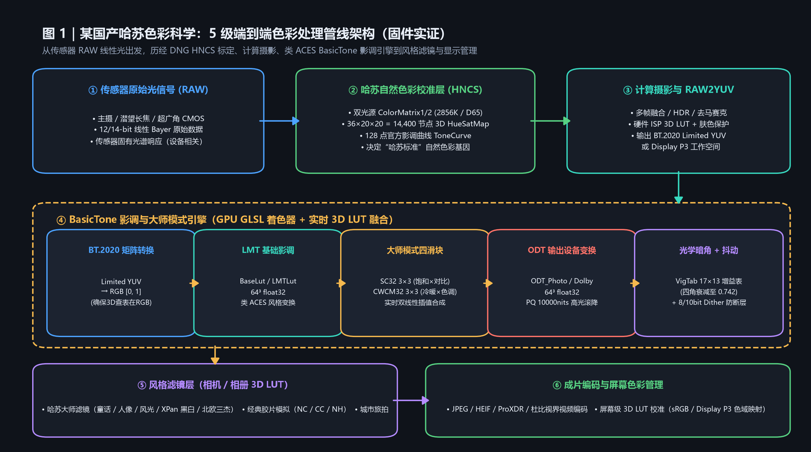
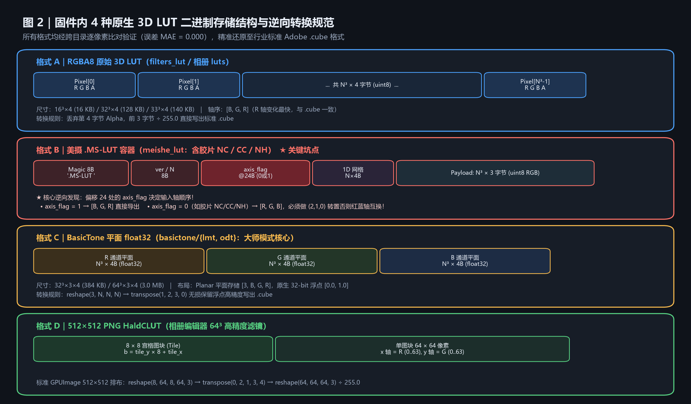
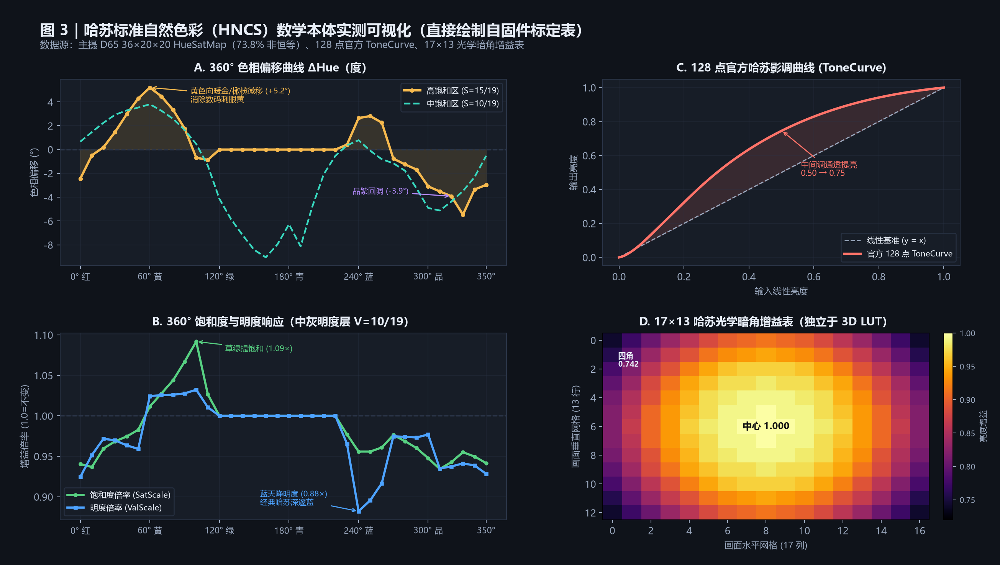
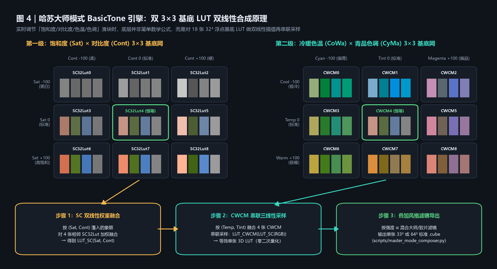
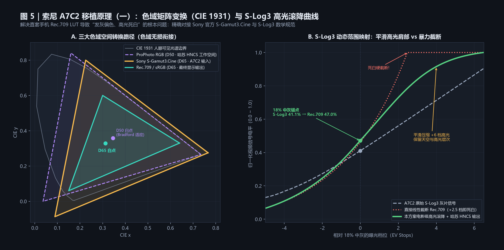
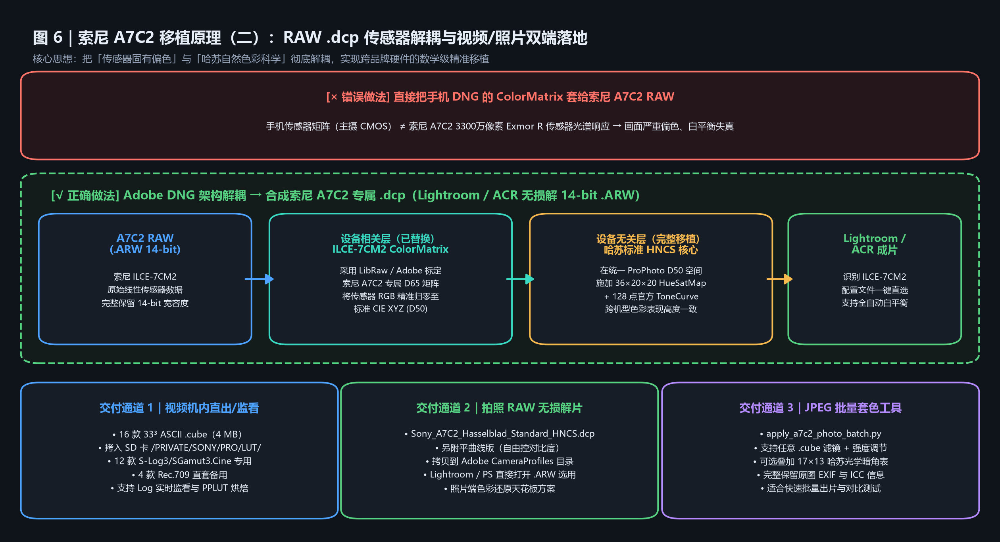
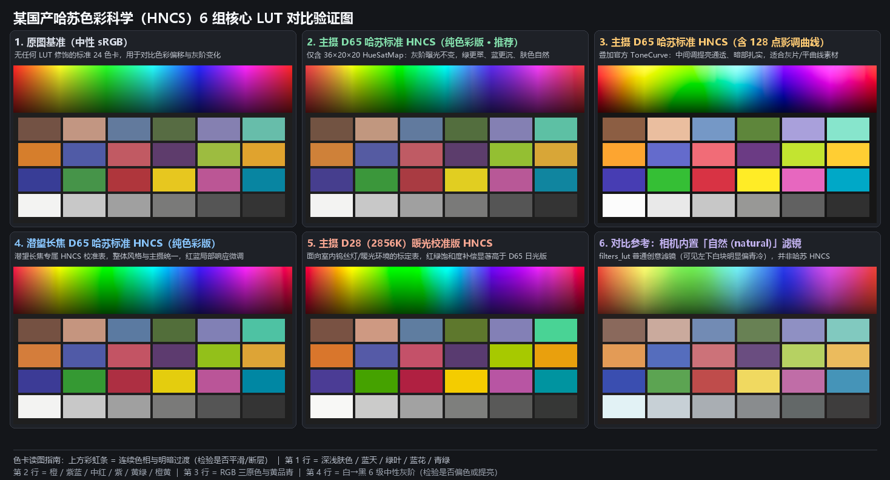
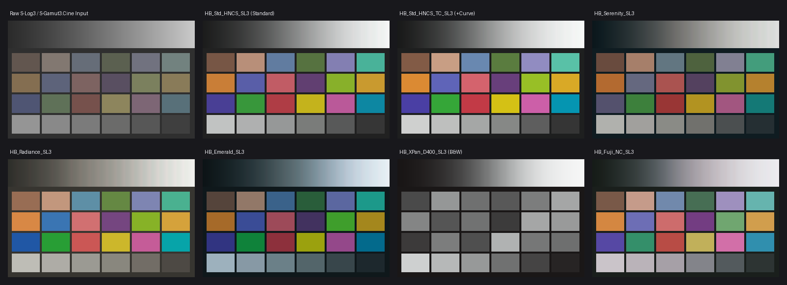

<div align="center">

# 某国产哈苏色彩科学（HNCS）管线解析与索尼 A7C2 移植工具链
### Mobile Hasselblad Color Science (HNCS) Pipeline Analysis & Sony A7C II Porting Toolkit

[简体中文](#-简体中文) &nbsp;|&nbsp; [English](#-english)

</div>

---

<a id="-简体中文"></a>
## 🇨🇳 简体中文

本项目完整拆解了**某国产哈苏色彩科学**的端到端色彩处理管线，完成了 4 种固件原生 3D LUT 二进制格式与 DNG 自然色彩标定表（`36×20×20 HueSatMap` + `128 点 ToneCurve` + `17×13` 光学暗角）的逆向解析、行业标准 `.cube` / `.dcp` 无损导出，并实现了面向 **索尼 A7C2（`ILCE-7CM2`）** 的纯净 **哈苏标准自然色彩（Std HNCS）** 全链路跨机移植方案（机内 3 款 S-Log3/Rec.709 33 点 `.cube` + Lightroom/ACR 无损 RAW `.dcp` + 离线批量套色工具）。

> **免责声明**：本仓库中的分析代码采用 MIT 协议开源；附带的示例 LUT / `.dcp` 配置文件与研究结论仅供**个人色彩科学与图像处理管线学习研究**，请勿用于任何商业用途。

### 一、核心工作原理（6 张高清技术原理图）

#### 1. 端到端 5 级色彩处理管线架构
从传感器线性 RAW 出发，经过 **HNCS 标定层 → 计算摄影 RAW2YUV → 类 ACES BasicTone 影调与大师模式引擎 → 风格滤镜层 → 屏幕色彩管理** 的完整数据流：



#### 2. 固件 4 种原生 3D LUT 二进制布局与轴序规范
所有二进制格式均经跨目录逐像素比对验证（`MAE = 0.000`）。其中最关键的逆向发现是 **`.MS-LUT` 容器偏移 24 处的 `axis_flag` 标志位**：当 `axis_flag = 0` 时（如胶片 NC / CC / NH）必须执行 `(2, 1, 0)` 轴转置，否则红蓝通道输入轴会互换。



#### 3. 哈苏标准自然色彩（HNCS）数学本体实测可视化
真正核心的“哈苏标准”并非一张普通滤镜，而是内置于 DNG 标定层的 **`36 × 20 × 20 = 14,400` 节点 3D `HueSatMap`**（73.8% 非恒等）、**128 点 `ToneCurve`** 与独立于 LUT 的 **`17 × 13` 光学暗角增益表**（四角衰减至 `0.742`）：



#### 4. 哈苏大师模式 `BasicTone` 双 3×3 基底 LUT 双线性合成原理
大师模式中的「饱和度 / 对比度 / 色温 / 色调」四滑块在底层并非简单代数公式，而是对 **两组 3×3 共 18 张 32³ 浮点基底 LUT** 执行双线性加权融合，再串联三线性采样输出等效单张 3D LUT：



#### 5. 索尼 A7C2 移植原理（一）：CIE 1931 色域变换与 S-Log3 电影高光滚降
按 Sony 官方数学公式完成 `S-Log3 解码 → S-Gamut3.Cine 转 ProPhoto D50（Bradford 适应）→ +6 档平滑电影肩部滚降 → 哈苏 HNCS → Rec.709` 的单张 33³ 重烘焙，将 18% 中灰精准锚定在 Rec.709 `47%`：



#### 6. 索尼 A7C2 移植原理（二）：RAW `.dcp` 传感器解耦与双端交付架构
利用 Adobe DNG 的分层解耦设计，将**设备相关层**替换为索尼 `ILCE-7CM2` 官方 D65 `ColorMatrix`，同时无损保留**设备无关层（ProPhoto D50）**的哈苏 `36×20×20 HueSatMap` 与 `128 点 ToneCurve`，实现 A7C2 14-bit `.ARW` 原片的精准哈苏色彩直解：



### 二、实测色卡对比验证





### 三、快速上手（中文）

#### A7C2 机内 3 款 Std HNCS LUT 区别与选用指南
> **重要避坑**：`HB_Std_HNCS_709.cube` **不包含 S-Log3 解码**！在 A7C2 机内 S-Log3 拍摄/监看时若误选 `_709`，画面仍会是灰片；拍 S-Log3 请务必使用带 **`_SL3`** 后缀的两款。

| 文件名 | 输入 → 输出 | 是否解 S-Log3 | 官方 128 点 ToneCurve | 18% 中灰输出 | 观感与推荐场景 |
| :--- | :--- | :---: | :---: | :---: | :--- |
| `HB_Std_HNCS_SL3.cube` | `S-Log3 / S-Gamut3.Cine → Rec.709` | **是** | 0%（纯 HNCS） | **`0.470`** | 贴近 Sony `s709`，光比自然沉稳、保留最多高光/暗部余量；**户外大光比与日常主力首选** |
| `HB_Std_HNCS_TC_SL3.cube` | `S-Log3 / S-Gamut3.Cine → Rec.709` | **是** | **叠加 35%** | **`0.515`** (+0.3 EV) | 中间调更明亮通透、肤色更显白净、暗部更扎实；**室内/阴天/人像直出首选** |
| `HB_Std_HNCS_709.cube` | `Rec.709 → Rec.709` | **否** | 0%（纯 HNCS） | `0.500` (不变) | 仅作用于已还原的常规 Rec.709 画面（如达芬奇 CST/`s709` 后级节点或非 Log 素材） |

- **索尼 A7C2 视频机内直出 / 监看**：将 `output/Sony_A7C2_Port/SD_CARD_COPY/PRIVATE` 文件夹直接复制到 SD 卡根目录 → 机内菜单 `曝光/颜色 → 颜色/色调 → 管理用户 LUT → 导入/编辑`（完整菜单配置见 [双语移植手册](docs/Sony_A7C2_Hasselblad_LUT_Porting_Guide.md)）。
- **索尼 A7C2 拍照 `.ARW` RAW 无损解片**：将 `output/Sony_A7C2_Port/Lightroom_ACR_DCP/*.dcp` 复制到 `C:\Users\<用户名>\AppData\Roaming\Adobe\CameraRaw\CameraProfiles\`，重启 Lightroom Classic / Photoshop (ACR) 即可选用。
- **离线批量套色（可选光学暗角）**：
  ```bash
  pip install -r requirements.txt
  python scripts/apply_a7c2_photo_batch.py \
      --input ./photos_in --output ./photos_out \
      --lut output/Hasselblad_Standard_HNCS/Hasselblad_Standard_HNCS_Main_D65_ColorOnly_33.cube \
      --strength 1.0 --vignette 0.5
  ```

---

<a id="-english"></a>
## 🇺🇸 English

This repository documents an end-to-end color science analysis of **a flagship mobile Hasselblad color science (HNCS) imaging pipeline**, provides verified binary parsers for 4 native firmware 3D LUT formats and DNG calibration tables (`36×20×20 HueSatMap` + `128-point ToneCurve` + `17×13` optical vignette map), and implements a mathematically calibrated **pure Hasselblad Standard (Std HNCS)** porting pipeline for the **Sony A7C II (`ILCE-7CM2`)**—delivering 3 ready-to-import in-camera 33-point `.cube` LUTs (S-Log3 / S-Gamut3.Cine & Rec.709), sensor-decoupled `.dcp` RAW camera profiles for Lightroom/ACR, and a batch still-photo processor.

> **Disclaimer**: All original Python scripts in this repository are released under the MIT License. Any derived LUT/DCP research profiles and findings are provided strictly for **personal color science study and educational pipeline research**; do not redistribute commercially.

### 1. How It Works (6 Data-Driven Technical Diagrams)

All 6 high-resolution diagrams in `docs/figures/` (embedded above) are generated directly from real calibration data and verified shader math:

1. **End-to-End 5-Stage Color Pipeline (`01_color_pipeline_architecture.png`)**: Sensor Linear RAW → DNG HNCS Calibration (`ColorMatrix1/2`, `36×20×20 HueSatMap`, `128-pt ToneCurve`) → Computational RAW2YUV → ACES-like `BasicTone` Engine (BT.2020 YUV→RGB, 64³ LMT/ODT, dual 3×3 Master Mode LUT blending, `17×13` vignette + dithering) → Style Filter Layer → Display Calibration.
2. **4 Native Firmware 3D LUT Binary Formats (`02_lut_binary_formats_layout.png`)**:
   - **RGBA8 Raw** (`N³ × 4` uint8, `[B, G, R, RGBA]`, R-fastest matching `.cube`).
   - **`.MS-LUT` Container** (magic `".MS-LUT "` + **`axis_flag` at byte offset 24**: `1` = `[B, G, R]`, **`0` = `[R, G, B]` requiring `(2, 1, 0)` transpose**—verified `MAE = 0.000` against peer LUTs).
   - **BasicTone Planar Float32** (`3 × N³ × 4` little-endian float32 in `[3, B, G, R]` planar layout, losslessly transposed to `.cube`).
   - **512×512 PNG HaldCLUT** (standard GPUImage `8×8` grid of `64×64` tiles → 64³ `.cube`).
3. **Mathematical Visualization of Hasselblad Standard HNCS (`03_hncs_color_science_data.png`)**: Real plotted curves from the `36×20×20` D65 `HueSatMap` (73.8% non-identity: `+5.2°` yellow shift toward warm olive-gold, restrained skin tones, `1.09×` lush foliage saturation, `0.88×` deeper cobalt sky luminance), `128-point ToneCurve`, and `17×13` optical vignette heatmap (`0.742` corners → `1.000` center).
4. **Master Mode `BasicTone` Dual 3×3 Basis LUT Engine (`04_master_mode_3x3_engine.png`)**: Real-time Saturation×Contrast (`SC32Lut0..8`) and Cool/Warm×Cyan/Magenta (`CWCM32Lut0..8`) sliders operate by bilinearly blending 4 neighboring 32³ float32 basis LUTs per grid and chaining trilinear lookup into a single merged LUT (`scripts/master_mode_composer.py`).
5. **Sony A7C II Porting Part 1 — Gamut & S-Log3 Highlight Roll-Off (`05_a7c2_gamut_and_slog3_rolloff.png`)**: Exact Sony `S-Log3` EOTF⁻¹ → `S-Gamut3.Cine` to `ProPhoto RGB (D50)` via Bradford chromatic adaptation → smooth +6-stop filmic shoulder (anchoring 18% middle gray at `41.1%` S-Log3 → `47.0%` Rec.709) → HNCS `36×20×20 HueSatMap` → Rec.709 OETF, baked into Sony-compliant 33³ `.cube` LUTs.
6. **Sony A7C II Porting Part 2 — RAW `.dcp` Sensor Decoupling (`06_a7c2_dcp_sensor_decoupling.png`)**: Replaces the device-dependent mobile sensor `ColorMatrix` with the calibrated **Sony `ILCE-7CM2` D65 `ColorMatrix`** (RAW → CIE XYZ D50) while preserving the device-independent ProPhoto D50 Hasselblad `HueSatMap` & `ToneCurve` for true 14-bit `.ARW` rendering in Lightroom Classic / ACR.

### 2. Repository Structure

```text
.
├── README.md                                             # Bilingual overview & technical principles
├── LICENSE                                               # MIT License (code)
├── requirements.txt                                      # Python dependencies (numpy, pillow, scipy, matplotlib)
├── docs/
│   ├── Sony_A7C2_Hasselblad_LUT_Porting_Guide.md         # Bilingual Sony A7C II setup & RAW workflow guide
│   └── figures/                                          # 6 technical principle diagrams + 2 ColorChecker sheets
├── scripts/
│   ├── export_all_luts.py                                # Multi-format firmware 3D LUT parser & .cube exporter
│   ├── export_hasselblad_standard.py                     # DNG HNCS (HueSatMap + ToneCurve) -> .cube / .dcp
│   ├── master_mode_composer.py                           # Master Mode 4-slider 3×3 bilinear LUT composer
│   ├── port_to_sony_a7c2.py                              # Sony A7C II 33pt S-Log3/Rec.709 LUT + ILCE-7CM2 .dcp builder
│   ├── apply_a7c2_photo_batch.py                         # Still-photo batch LUT + optical vignette processor
│   ├── verify_and_preview.py                             # Automated .cube validator & ColorChecker preview renderer
│   ├── generate_principle_diagrams.py                    # Reproducible generator for all 6 principle figures
│   └── render_standard_comparison_zh.py                  # Annotated 6-way HNCS ColorChecker comparison renderer
└── output/
    ├── Sony_A7C2_Port/
    │   ├── SD_CARD_COPY/PRIVATE/SONY/PRO/LUT/            # 3 pure Std HNCS Sony-compliant 33pt ASCII LF .cube LUTs
    │   └── Lightroom_ACR_DCP/                            # 2 Sony ILCE-7CM2 Std HNCS .dcp RAW profiles (Full & FlatCurve)
    └── Hasselblad_Standard_HNCS/                         # 5 universal 33pt Std HNCS .cube LUTs
```

### 3. Quick Start (English)

#### Differences Between the 3 A7C II Std HNCS LUTs
> **Important Note**: `HB_Std_HNCS_709.cube` **does NOT decode S-Log3**. Loading `_709` directly on S-Log3 footage will leave the image flat/gray—always use the **`_SL3`** LUTs for in-camera S-Log3 monitoring/recording.

| Filename | Input → Output | Decodes S-Log3 | 128-pt ToneCurve | 18% Gray Out | Look & Best Use |
| :--- | :--- | :---: | :---: | :---: | :--- |
| `HB_Std_HNCS_SL3.cube` | `S-Log3 / S-Gamut3.Cine → Rec.709` | **Yes** | 0% (Pure HNCS) | **`0.470`** | Balanced filmic contrast matching Sony `s709`, max highlight/shadow headroom; **best general & bright outdoor choice** |
| `HB_Std_HNCS_TC_SL3.cube` | `S-Log3 / S-Gamut3.Cine → Rec.709` | **Yes** | **35% Blended** | **`0.515`** (+0.3 EV) | Brighter airy midtones, cleaner glowing skin tones, firmer shadow toe; **best for indoors, overcast, and SOOC portraits** |
| `HB_Std_HNCS_709.cube` | `Rec.709 → Rec.709` | **No** | 0% (Pure HNCS) | `0.500` (unchanged) | Color-only look LUT for already-normalized Rec.709 footage (e.g., after a DaVinci CST / `s709` node, or non-Log stills/video) |

- **Sony A7C II In-Camera Video (S-Log3 Monitoring / PPLUT Recording)**:
  Copy `output/Sony_A7C2_Port/SD_CARD_COPY/PRIVATE` directly to the root of your A7C II SD card → `Menu → Exposure/Color → Color/Tone → Manage User LUTs → Import/Edit` (see the [Bilingual Sony A7C II Porting Guide](docs/Sony_A7C2_Hasselblad_LUT_Porting_Guide.md#english-guide) for full camera menu settings).
- **Sony A7C II `.ARW` RAW in Lightroom Classic / ACR**:
  Copy `output/Sony_A7C2_Port/Lightroom_ACR_DCP/*.dcp` into `C:\Users\<User>\AppData\Roaming\Adobe\CameraRaw\CameraProfiles\` (macOS: `~/Library/Application Support/Adobe/CameraRaw/CameraProfiles/`), restart Lightroom/ACR, and select **`Sony A7C II - Hasselblad Standard (HNCS)`** under Profile Browser.
- **CLI Batch Processing & Custom Master Mode Composer**:
  ```bash
  pip install -r requirements.txt

  # Batch-apply Hasselblad Standard HNCS (+ optional 50% optical vignette) to A7C II JPEGs/TIFFs
  python scripts/apply_a7c2_photo_batch.py \
      --input ./photos_in --output ./photos_out \
      --lut output/Hasselblad_Standard_HNCS/Hasselblad_Standard_HNCS_Main_D65_ColorOnly_33.cube \
      --strength 1.0 --vignette 0.5

  # Compose a custom Master Mode 33pt LUT from Sat/Cont/Temp/Tint sliders
  python scripts/master_mode_composer.py \
      --sat 10 --cont 15 --temp 12 --tint -4 --size 33 \
      --out ./custom_master_look_33.cube
  ```
