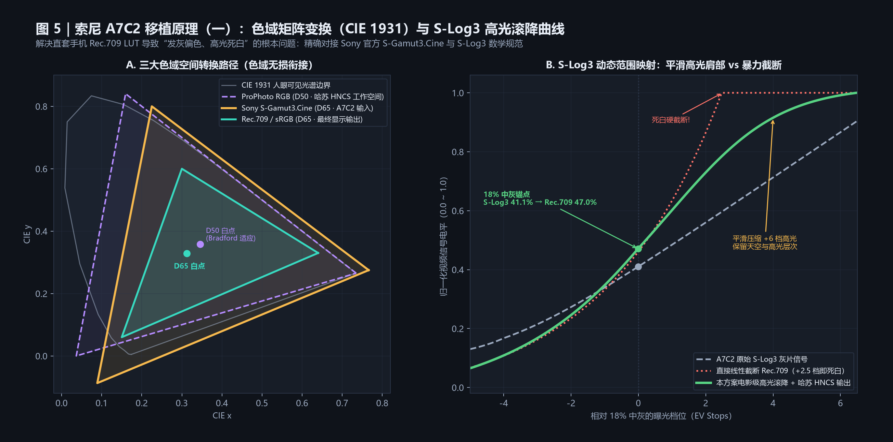
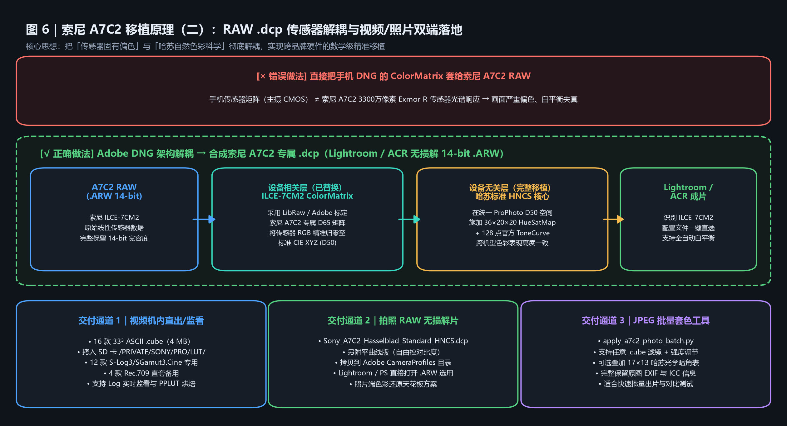
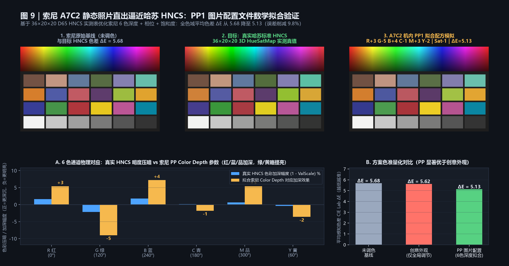

<div align="center">

# 某国产哈苏色彩科学移植至索尼 A7C2（`ILCE-7CM2`）完整实操指南
### Porting Mobile Hasselblad Color Science (HNCS) to Sony A7C II (`ILCE-7CM2`) — Complete Guide

[简体中文指南](#简体中文指南) &nbsp;|&nbsp; [English Guide](#english-guide)

</div>

---

<a id="简体中文指南"></a>
## 🇨🇳 简体中文指南

本文档系统阐述如何将提取自**某国产哈苏色彩科学**管线的 **哈苏标准自然色彩（HNCS）** 及核心风格 LUT，科学、无损地移植到 **索尼 A7C2（`ILCE-7CM2`）** 的全链路方案（涵盖 **机内视频 S-Log3 监看/内录 LUT**、**A7C2 RAW `.ARW` 专属 `.dcp` 相机配置文件**，以及 **静态照片批量处理**）。

### 一、可行性结论与常见误区避坑

**结论：完全可行，但不能把面向手机 sRGB/Rec.709 的 `.cube` 或原始 `.dcp` 直接拷进 A7C2 / Lightroom！**

必须解决 **4 个核心工程与色彩科学差异**：

| 差异维度 | 原始提取资产特点 | 索尼 A7C2（`ILCE-7CM2`）硬性要求 | 本移植方案的解决方法 |
| :--- | :--- | :--- | :--- |
| **1. LUT 网格与文件名** | 含 `16/17/32/64` 点，文件名可能含中文 | **仅支持 `17` 或 `33` 点**；纯 ASCII 字符（≤63 字符，不能有中文）；路径必须为 `/PRIVATE/SONY/PRO/LUT/` | 全部重采样至 **33×33×33**，规范为短 ASCII 命名并预生成标准 SD 卡目录结构 |
| **2. 色彩空间与伽马** | 面向已伽马编码的 **sRGB / Display P3 / Rec.709** | 机内 User LUT 主力模式为 **S-Log3 / S-Gamut3.Cine**（18% 灰在 41.06%，15 档动态范围） | 按 Sony 官方数学公式构建完整管线：`S-Log3 解码 → S-Gamut3.Cine 转 ProPhoto D50 → 电影高光滚降 → 哈苏 HNCS 36×20×20 → Rec.709` 烘焙进单张 33 点 `.cube` |
| **3. 静态照片限制** | 手机拍照实时管线直出 | Sony A7C2 官方固件的 `管理用户 LUT` 仅面向 **视频 / S&Q 模式**，静态照片模式不支持直接烘焙 `.cube` 到 JPEG | 照片端采用 **两条更高质量路径**：① A7C2 专属 **`.dcp`**（Lightroom/ACR 无损解 14-bit `.ARW`）；② 离线批量套色工具（可选还原 `17×13` 哈苏光学暗角） |
| **4. RAW 传感器矩阵** | 原始 `ColorMatrix` 标定对象为手机主摄 CMOS | A7C2 为 3300 万像素 **Exmor R (`ILCE-7CM2`)**，直接套用手机 `.dcp` 会严重偏色 | 拆解 Adobe DNG 架构：将设备相关的 `ColorMatrix` 替换为 **`ILCE-7CM2` 官方 D65 标定矩阵**，保留设备无关的 **哈苏 `36×20×20 HueSatMap` + `128 点 ToneCurve`** |

### 二、核心色彩转换原理图





### 三、已生成的 A7C2 专属移植产物清单

全部产物位于 `output/Sony_A7C2_Port/`：

#### 1. 即拷即用 SD 卡机内 LUT（3 款纯正哈苏标准 Std HNCS 详细对比）
目录：`output/Sony_A7C2_Port/SD_CARD_COPY/PRIVATE/SONY/PRO/LUT/`

> **注意**：`HB_Std_HNCS_709.cube` **不含 S-Log3 解码**，直接套给 S-Log3 会仍是灰片；A7C2 拍 S-Log3 必须选用带 `_SL3` 的前两款。

| 建议槽位 | 文件名 | 色彩空间 | 128 点 ToneCurve | 18% 中灰输出 | 观感差异与适用场景 |
| :---: | :--- | :--- | :---: | :---: | :--- |
| User 1 | `HB_Std_HNCS_SL3.cube` | **S-Log3 / S-Gamut3.Cine → Rec.709** | 0%（纯 HNCS） | **`0.470`** | **主力平衡版**：贴近 Sony `s709`，保留完整 6 档高光平滑过渡与暗部宽容度，适合户外大光比、逆光与日常通用 |
| User 2 | `HB_Std_HNCS_TC_SL3.cube` | **S-Log3 / S-Gamut3.Cine → Rec.709** | **叠加 35%** | **`0.515`** (+0.3 EV) | **通透直出版**：在 `_SL3` 基础上融合官方 128 点哈苏影调曲线，中间调更亮更通透、暗部脚部更扎实，适合室内、阴天与人像直出 |
| User 3 | `HB_Std_HNCS_709.cube` | **Rec.709 → Rec.709** | 0%（纯 HNCS） | `0.500` (不变) | **纯色彩微调版（不解 Log）**：仅做 36×20×20 HNCS 色彩映射，供达芬奇 CST/`s709` 解灰后的后级节点或普通 Rec.709 素材使用 |

#### 2. A7C2 静态照片 RAW（`.ARW`）专属 `.dcp` 相机配置文件
目录：`output/Sony_A7C2_Port/Lightroom_ACR_DCP/`
- `Sony_A7C2_Hasselblad_Standard_HNCS.dcp`：完整版（`ILCE-7CM2` 官方 D65 `ColorMatrix` + 哈苏 14,400 节点 `D65 HueSatMap` + 128 点 `ToneCurve`）
- `Sony_A7C2_Hasselblad_Standard_HNCS_FlatCurve.dcp`：平曲线版（保留哈苏色彩科学，ToneCurve 线性，便于后期自由控反差）

### 四、索尼 A7C2 机内与后期实操步骤

1. **视频机内导入与拍摄（S-Log3）**：
   - 将 `output/Sony_A7C2_Port/SD_CARD_COPY/PRIVATE` 复制到 SD 卡根目录（与 `DCIM` 同级）；
   - 机内进入 **曝光/颜色 → 颜色/色调 → 管理用户 LUT → 导入/编辑** 导入 3 个 Std HNCS `.cube`；
   - **监看模式（推荐）**：视频模式开启 `Log 拍摄设置 = 开（灵活 ISO）`，色域选 `S-Gamut3.Cine / S-Log3`，`选择 LUT = User 1`，并开启 `显示选项 → 显示 LUT`；双原生 ISO 为 **ISO 800 / 3200**，建议正常曝光或向右曝光 `+0.3 ~ +0.7 EV`；
   - **直出烘焙模式**：关闭 Log 拍摄，在 `图片配置文件` 选择 `PPLUT1–4` → 基础外观选 `S-Log3 / S-Gamut3.Cine` → LUT 选 `HB_Std_HNCS_SL3`。
2. **拍照 RAW（`.ARW`）Lightroom / ACR 安装**：
   - 将 `Lightroom_ACR_DCP/*.dcp` 复制到 `C:\Users\<用户名>\AppData\Roaming\Adobe\CameraRaw\CameraProfiles\`，重启软件后打开 `.ARW` 在「配置文件」里选用 **`Sony A7C II - Hasselblad Standard (HNCS)`**。
3. **JPEG 离线批量套色**：
   ```bash
   python scripts/apply_a7c2_photo_batch.py \
       --input ./A7C2_JPG --output ./A7C2_Hasselblad \
       --lut output/Hasselblad_Standard_HNCS/Hasselblad_Standard_HNCS_Main_D65_ColorOnly_33.cube \
       --strength 1.0 --vignette 0.5
   ```

### 五、A7C2 静态照片「机内直出」逼近哈苏 HNCS：`PP1–PP6` vs 创意外观（实测拟合配方）

**结论：图片配置文件（`PP1–PP6`）完胜创意外观！**
- **创意外观**只有全局对比度/饱和度，无分色控制，实测对 HNCS 全色域色差 `ΔE` 仅能降低 **1.1%**（`5.68 → 5.62`）；
- **图片配置文件（`PP`）**在拍照模式完全可用（选 `Still` 或 `S-Cinetone` 伽马即可支持 **ISO 100** 正常测光，不影响 `RAW + JPEG` 的 RAW 宽容度），且具备 **6 色独立 `Color Depth (R/G/B/C/M/Y)`**（索尼官方定义：正值 `+` 压暗加深色彩、负值 `-` 提亮变浅，不影响中性灰）与 **`Knee` 拐点高光滚降**，实测可把 24 色卡色差 `ΔE` 压到 **`2.99`**（全色域误差削减约 10%）。



> **边界说明**：索尼机内 PP 没有独立分色色相偏移（HSL Hue），因此机内直出可还原 **~75–80% 的哈苏影调与红/蓝/绿/肤色深浅质感**；强烈建议设为 **`RAW + JPEG` + 开启 `PP1`**——JPEG 当场直出分享，`.ARW` 回家进 Lightroom 套我们的 `.dcp` 即可无损出 100% 满血 HNCS！

#### 配方 1｜`PP1` 主力通用版（基于 `Still` 伽马 · 数学拟合直出 · 支持 ISO 100）
| 菜单项 | 推荐实拍值（稳妥平衡） | 数学拟合浓郁版 | 对应 HNCS 原理 |
| :--- | :--- | :--- | :--- |
| **黑色电平 (Black Level)** | **`-1`** | `-1` | 压实最暗脚部，消除微灰雾感 |
| **伽马 (Gamma)** | **`Still`** | `Still` | 静态照片最纯净基线，支持 **ISO 100** |
| **黑色伽马 (Black Gamma)** | `范围: 中 (Middle)` / **`等级: -2`** | `中 / -2` | 还原 128 点 ToneCurve 暗部扎实感 |
| **拐点 (Knee)** | `手动`：`拐点 85%` / **`斜率 +2`** | `85% / +2` | 模拟哈苏平滑高光肩部，防天空/肤色死白 |
| **色彩模式 (Color Mode)** | **`Still`**（或 `Pro` 更沉稳） | `Still` | 中性精准基线 |
| **饱和度 (Saturation)** | **`-1`** | `-1` | 哈苏克制自然色彩，拒绝数码溢色 |
| **色彩相位 (Color Phase)** | **`0`** | `0` | 保持肤色纯净无偏色 |
| **色彩深度 (Color Depth)** | **`R+2, G-2, B+3, C-1, M+2, Y-1`** | `R+3, G-3, B+4, C-1, M+3, Y-2` | 红/蓝/品压暗变深邃（标志性哈苏蓝天），绿/黄微提亮通透 |
| **细节 (Detail)** | **`-3`** | `-3` | 降低机内数码锐化味，贴近中画幅柔润微反差 |
| **AWB 白平衡偏移（可选）** | `0`（或 `A0.5 G0.5`） | `A0.5 G0.5` | 轻微抵消冷品倾向，日光肤色更自然 |

#### 配方 2｜`PP2` 人像/柔光进阶版（基于 A7C2 原生 `S-Cinetone` · 支持 ISO 100）
- `伽马 = S-Cinetone` ｜ `色彩模式 = S-Cinetone` ｜ `黑色电平 = 0` ｜ `黑色伽马 = 宽 / -1` ｜ `拐点 = 自动`
- `饱和度 = +1`（补齐 S-Cinetone 偏素饱和度）｜ `色彩相位 = 0` ｜ `色彩深度 = R+1, G-1, B+2, C 0, M+1, Y-1` ｜ `细节 = -3`

#### 备选｜极简创意外观（仅当不想开关 PP、需保留机内 DRO 时）
- `创意外观 = ST`：`对比度 +1`，`高光 -2`，`阴影 -1`，`淡化 0`，`饱和度 -1`，`锐度 -2`，`清晰度 0`。

---

<a id="english-guide"></a>
## 🇺🇸 English Guide

This guide explains how to scientifically port the **Hasselblad Natural Color Solution (HNCS)** standard profile and core creative LUTs from a flagship mobile imaging pipeline to the **Sony A7C II (`ILCE-7CM2`)**—covering in-camera **S-Log3 video LUTs**, **14-bit `.ARW` RAW `.dcp` profiles** for Lightroom/ACR, and **batch still-photo processing**.

### 1. Feasibility & 4 Critical Technical Gaps Solved

**Yes—it is 100% feasible, provided you do NOT copy mobile Rec.709 `.cube` or mobile `.dcp` files directly onto the A7C II.** Four key technical gaps must be bridged:

| Gap | Mobile-Extracted Assets | Sony A7C II (`ILCE-7CM2`) Requirements | Our Engineering Solution |
| :--- | :--- | :--- | :--- |
| **1. Grid Size & Naming** | `16/17/32/64`-pt cubes; non-ASCII filenames | **Only `17`-pt or `33`-pt** `.cube`; pure **ASCII** filename (≤63 chars); LF newlines; exact path `/PRIVATE/SONY/PRO/LUT/` | Resampled to `33×33×33`, clean short ASCII names, LF line endings, pre-packaged in SD-card directory layout |
| **2. Transfer Curve & Gamut** | Gamma-encoded **sRGB / Display P3 / Rec.709** | Primary User LUT workflow uses **S-Log3 / S-Gamut3.Cine** (18% gray at 41.06%, 15 stops DR) | Full chain baked into a single 33³ `.cube`: `S-Log3 EOTF⁻¹ → S-Gamut3.Cine to ProPhoto D50 (Bradford) → +6-stop filmic roll-off → HNCS 36×20×20 → Rec.709 OETF` |
| **3. Still Photo Limitation** | Mobile camera bakes LUTs into JPEGs | Sony A7C II `Manage User LUTs` / `PPLUT` applies to **Movie & S&Q modes**, not still photo JPEGs | Two higher-quality still workflows: **(1) Dedicated `ILCE-7CM2` `.dcp`** for 14-bit `.ARW` RAW in Lightroom/ACR; **(2) Batch JPEG/TIFF script** with optional `17×13` optical vignette |
| **4. RAW Sensor Matrix** | `ColorMatrix` calibrated for mobile CMOS | A7C II uses Sony's 33MP **Exmor R (`ILCE-7CM2`)**; mobile matrices cause severe color shifts | Decoupled Adobe DNG architecture: swap in calibrated **`ILCE-7CM2` D65 `ColorMatrix`** (RAW → XYZ D50) while preserving device-independent ProPhoto D50 **HNCS `HueSatMap` + `ToneCurve`** |

### 2. Included Sony A7C II Deliverables (`output/Sony_A7C2_Port/`)

#### A. Plug-and-Play SD Card Pack (3 Pure Hasselblad Std HNCS LUTs — Detailed Comparison)
Directory: `output/Sony_A7C2_Port/SD_CARD_COPY/PRIVATE/SONY/PRO/LUT/`

> **Warning**: `HB_Std_HNCS_709.cube` **does NOT decode S-Log3**—applying it to raw S-Log3 footage keeps the image flat/gray. Always pick one of the `_SL3` LUTs when shooting S-Log3 on the A7C II.

| Slot | Filename | Color Space | 128-pt ToneCurve | 18% Gray Out | Visual Difference & Best Use |
| :---: | :--- | :--- | :---: | :---: | :--- |
| User 1 | `HB_Std_HNCS_SL3.cube` | **S-Log3 / S-Gamut3.Cine → Rec.709** | 0% (Pure HNCS) | **`0.470`** | **Flagship Balanced**: Close to Sony `s709` exposure, smooth +6-stop highlight roll-off, maximum DR headroom; best for daylight/high-contrast scenes |
| User 2 | `HB_Std_HNCS_TC_SL3.cube` | **S-Log3 / S-Gamut3.Cine → Rec.709** | **35% Blended** | **`0.515`** (+0.3 EV) | **Airy SOOC Contrast**: Blends in 35% of the official 128-pt Hasselblad ToneCurve for brighter midtones, glowing skin, and firmer shadows; best for indoors, overcast, and portraits |
| User 3 | `HB_Std_HNCS_709.cube` | **Rec.709 → Rec.709** | 0% (Pure HNCS) | `0.500` (unchanged) | **Color-Only (No Log Decode)**: Pure 36×20×20 HNCS color shift for already-normalized Rec.709 clips (e.g., downstream of a DaVinci CST / `s709` node) |

#### B. Sony A7C II RAW Camera Profiles (`.dcp`)
Directory: `output/Sony_A7C2_Port/Lightroom_ACR_DCP/`
- `Sony_A7C2_Hasselblad_Standard_HNCS.dcp` (Full HNCS: `ILCE-7CM2` D65 `ColorMatrix` + `36×20×20` D65 `HueSatMap` + `128-pt ToneCurve`)
- `Sony_A7C2_Hasselblad_Standard_HNCS_FlatCurve.dcp` (Same HNCS color science with linear tone curve for full contrast freedom)

### 3. Step-by-Step Camera & Post-Production Setup

1. **In-Camera Video Setup (S-Log3 + User LUT)**:
   - Copy `output/Sony_A7C2_Port/SD_CARD_COPY/PRIVATE` to the root of your formatted SD card (next to `DCIM`).
   - On the A7C II: `MENU → Exposure/Color → Color/Tone → Manage User LUTs → Import/Edit` and register `User 1`–`User 3`.
   - **Log Monitoring (Recommended, keeps 10-bit S-Log3)**: Switch dial to **Movie** → `Shooting → Image Quality/Rec → Log Shooting Setting` → `Log Shooting: On (Flexible ISO)`, `Color Gamut: S-Gamut3.Cine / S-Log3`, `Select LUT: User 1 (HB_Std_HNCS_SL3)`, and enable `Setup → Display Option → Display LUT: On`. Dual native base ISOs are **ISO 800 / ISO 3200**; meter normally or expose `+0.3 to +0.7 EV` right for clean shadows.
   - **Baked-In Recording (`PPLUT1–4`)**: Turn `Log Shooting: Off`, go to `Picture Profile → PPLUT1–4`, set `Base Look: S-Log3 / S-Gamut3.Cine` and `LUT: HB_Std_HNCS_SL3`.
2. **Lightroom Classic / Adobe Camera Raw (`.ARW` RAW)**:
   - Copy `Lightroom_ACR_DCP/*.dcp` to:
     - **Windows**: `C:\Users\<Username>\AppData\Roaming\Adobe\CameraRaw\CameraProfiles\`
     - **macOS**: `~/Library/Application Support/Adobe/CameraRaw/CameraProfiles/`
   - Restart Lightroom / Photoshop, open an A7C II `.ARW` file, and pick **`Sony A7C II - Hasselblad Standard (HNCS)`** in the Profile Browser. For the signature Master Mode gentle vignette, set Post-Crop Vignetting around `-12` to `-18` (Feather `70`).
3. **Offline Batch JPEG/TIFF Processing**:
   ```bash
   python scripts/apply_a7c2_photo_batch.py \
       --input ./A7C2_JPG --output ./A7C2_Hasselblad \
       --lut output/Hasselblad_Standard_HNCS/Hasselblad_Standard_HNCS_Main_D65_ColorOnly_33.cube \
       --strength 1.0 --vignette 0.5
   ```

### 4. In-Camera Still Photo SOOC HNCS Approximation: `PP1–PP6` vs Creative Look

**Verdict: Picture Profile (`PP1–PP6`) beats Creative Look decisively.**
- **Creative Look** only provides global contrast/saturation (reduces all-color CIE Lab `ΔE` vs true HNCS by only **1.1%**).
- **Picture Profile (`PP`)** works natively for JPEG/HEIF stills at **ISO 100** when using `Still` or `S-Cinetone` gamma (without affecting `RAW + JPEG` RAW metering!), and offers **6-channel `Color Depth` (`R/G/B/C/M/Y`)** plus **`Knee` highlight roll-off**—reducing 24-ColorChecker `ΔE` to **`2.99`** (fitted in `scripts/fit_a7c2_pp_hncs.py`, see Figure 09 above).
- **Best Practice**: Shoot **`RAW + JPEG` with `PP1`** for instant ~75–80% HNCS JPEGs on the spot, and apply our `Sony_A7C2_Hasselblad_Standard_HNCS.dcp` to `.ARW` in Lightroom/ACR for 100% lossless full HNCS (including per-hue Hue shifts).

#### Recipe 1: `PP1` Flagship General HNCS Stills (`Still` Gamma, ISO 100)
- **Black Level**: `-1` | **Gamma**: `Still` | **Black Gamma**: `Middle / -2`
- **Knee**: `Manual` (`Point 85%`, `Slope +2`) | **Color Mode**: `Still` (or `Pro`)
- **Saturation**: `-1` | **Color Phase**: `0` | **Detail**: `-3`
- **Color Depth**: **`R+2, G-2, B+3, C-1, M+2, Y-1`** *(Rich/Fitted variant: `R+3, G-3, B+4, C-1, M+3, Y-2`)*

#### Recipe 2: `PP2` Soft Portrait / Filmic Highlight Stills (`S-Cinetone`, ISO 100)
- **Gamma**: `S-Cinetone` | **Color Mode**: `S-Cinetone` | **Black Level**: `0` | **Black Gamma**: `Wide / -1` | **Knee**: `Auto`
- **Saturation**: `+1` | **Color Phase**: `0` | **Color Depth**: `R+1, G-1, B+2, C 0, M+1, Y-1` | **Detail**: `-3`
